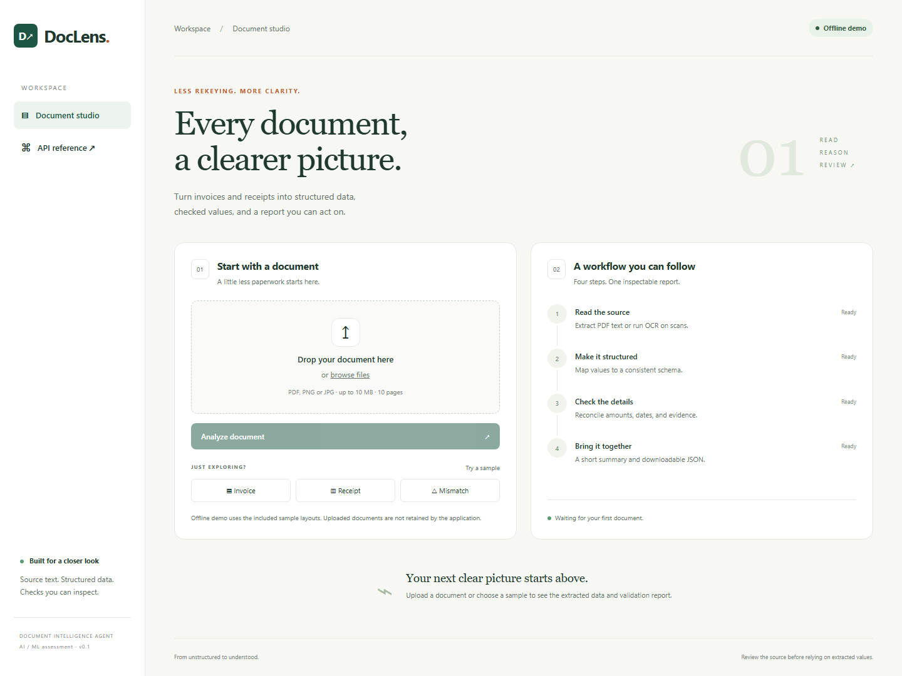

# DocLens — Document Intelligence Agent

Upload an invoice or receipt, and DocLens reads it, extracts the main details, checks the amounts, and writes a short summary using Google Gemini. You can review the result in your browser, download the JSON, or come back to the saved report later.

This project was built for the Appfuxion AI Engineer take-home assessment. The API, document processing tools, web interface, and tests are all in this repository.

[Get started](#get-started) · [Upload a document](#upload-a-document) · [How it works](#how-it-works) · [Engineering notes](ENGINEERING_NOTES.md)



## What you get

- Support for PDF, PNG, and JPG files, including scanned invoices.
- Extracted vendor details, document numbers, dates, currencies, totals, and line items.
- Checks for missing information, invalid dates or currencies, and amounts that do not add up.
- A Gemini summary that includes any issues found during validation.
- Saved originals and reports, with a document ID and a link you can bookmark.

For example, the included **Mismatch** invoice shows a total of MYR 3,255, while its subtotal and tax add up to MYR 3,250. DocLens keeps the printed amount and flags the difference for review.

## Get started

Docker is the easiest way to run the full app because it includes Tesseract, the OCR engine used for scans and images. You will need Git, Docker with Compose, and a [Gemini API key](https://aistudio.google.com/api-keys) to process your own documents.

**1. Clone the repository.**

```sh
git clone https://github.com/chenming7777/document-intelligence-agent.git
cd document-intelligence-agent
```

**2. Create your configuration.**

On Windows PowerShell:

```powershell
Copy-Item .env.example .env
```

On macOS or Linux, use `cp .env.example .env`. If you already have a `.env` file, keep it and edit the existing settings.

Open `.env` in your editor and set:

```dotenv
DOCINTEL_PROVIDER=gemini
GEMINI_API_KEY=your-key-here
GEMINI_MODEL=gemini-3.8-flash
```

Keep `TESSERACT_CMD` empty when using Docker. The API key stays on the server, and `.env` is excluded from Git.

**3. Start the app.**

Make sure Docker is running, then use:

```sh
docker compose up -d --build
```

Open **http://127.0.0.1:8000**. The first build takes a little longer because it installs the dependencies.

If you change your `.env` settings later, apply them with `docker compose up -d --force-recreate`.

### Try it without an API key

Leave `DOCINTEL_PROVIDER=demo` in `.env` and start the app the same way. Click **Invoice**, **Receipt**, or **Mismatch** to try the included samples.

Demo mode uses a small parser and a template summary for those sample layouts. It does not call an AI model. Use Gemini mode for your own invoices and receipts and to demonstrate the assessment's LLM workflow.

<details>
<summary>Prefer to run directly with Python?</summary>

Use Python 3.10 or newer. From the repository folder, create a virtual environment and install the pinned dependencies:

```powershell
python -m venv .venv
.\.venv\Scripts\Activate.ps1
python -m pip install -r requirements.lock
python -m pip install --no-deps -e .
python -m uvicorn docintel.api:app --host 127.0.0.1 --port 8000 --no-access-log
```

On macOS or Linux, activate the environment with `source .venv/bin/activate`. Set up `.env` as described above before starting the server.

Text PDFs can be read without OCR. For scanned PDFs and images, install Tesseract and its language data. On Windows, put it on PATH or set its installed location in `.env`, for example:

```dotenv
TESSERACT_CMD=C:\Program Files\Tesseract-OCR\tesseract.exe
OCR_LANGUAGE=eng
```

On Debian or Ubuntu, install it with `sudo apt-get install tesseract-ocr tesseract-ocr-eng`. Other OCR languages need their corresponding Tesseract language packs.

</details>

## Upload a document

1. Open **http://127.0.0.1:8000**.
2. Drag your PDF or image into the upload box, or click **browse files**.
3. Click **Analyze document** and wait for the report.
4. Review the extracted fields, line items, summary, and validation findings.

You can upload directly from Downloads or any other folder. There is no need to move the file into this repository. The default limit is **10 MB and 10 pages per document**.

Use **Structured JSON** to see the full result, or **Source & trace** to inspect the extracted text and processing steps. You can download the JSON report and the original file. Bookmark the report URL if you want to open it again later.

**Checks passed** means the configured checks found no issues. **Needs review** means some information is missing, uncertain, or inconsistent; the report explains what needs attention. Compare the extracted values with the original before using them.

## How it works

1. **Save the upload.** The API stores the original document and assigns it a unique ID.
2. **Read the text.** It reads embedded PDF text where available and uses Tesseract OCR for images and scanned pages.
3. **Extract the fields.** Gemini returns structured JSON, which is checked against a Pydantic schema.
4. **Validate the result.** Python checks required fields, dates, currencies, evidence quotes, and financial calculations using decimal arithmetic.
5. **Write and save the report.** Gemini summarizes the final values and validation findings. The interface displays the report when processing finishes.

The agent can ask Gemini to check the source once more if an extraction issue needs another look. It keeps the new result only if validation improves. A total that does not add up is reported as a discrepancy; it is not rewritten to make the checks pass.

Missing values stay `null`. Money is returned as decimal strings, such as `"3250.00"`, to preserve precision.

The design decisions, prompts, limitations, and assessment checklist are in [ENGINEERING_NOTES.md](ENGINEERING_NOTES.md).

## API and command line

Once the server is running, open **http://127.0.0.1:8000/docs** for the interactive API documentation.

| Endpoint | Purpose |
| --- | --- |
| `POST /documents` | Upload a file and start processing |
| `GET /documents/{document_id}` | Check the status and retrieve the finished report or error |
| `GET /documents/{document_id}/source` | Download the stored original |
| `POST /api/analyze` | Upload and wait for the full report in one request |
| `GET /health` | Check whether the app is running and its provider is configured |

Upload a sample using the API:

```sh
curl -F "file=@src/docintel/samples/invoice.pdf" http://127.0.0.1:8000/documents
```

On Windows PowerShell, use `curl.exe`. The response includes a document ID and a `status_url`. Request that URL until the status changes from `processing` to `completed` or `failed`.

A completed response contains the extracted fields in `report.document`, the checks in `report.validation`, and the summary in `report.summary`. A document can finish processing successfully and still need review because its amounts do not match.

If you installed the Python package, you can also process a file from the command line:

```sh
docintel src/docintel/samples/invoice.pdf --provider demo --output output/report.json
```

Use `--provider gemini` for your own files. The CLI writes the report to the specified output file; it does not add documents to the API's saved reports. Exit codes are `0` for passed checks, `2` for a report that needs review, and `1` for a processing failure.

## Storage and current limits

Docker keeps originals and reports in the `document_data` volume, so they survive container restarts and rebuilds. Running directly with Python stores them in `data/documents.sqlite3`; `DOCINTEL_DATA_DIR` changes that location. Stored documents remain until the operator removes them.

OCR and validation run locally. In Gemini mode, extracted text and structured data are sent to Google for extraction and summarization. The API key is never sent to the browser.

This version is intended to run locally, with **one server process per database**. It has no sign-in or document ownership controls, and the application does not encrypt stored files. If processing is interrupted by a server restart, the document is marked as failed with a message asking you to upload it again.

Clear, printed invoices and receipts are the main use case. Handwriting, poor scans, complex tables, and multiple invoices in one upload may need additional handling. The [engineering notes](ENGINEERING_NOTES.md#improvements-for-production) describe what would need to change for a public deployment.

## Tests

From an installed Python development environment:

```sh
python -m pytest --cov=docintel --cov-report=term-missing
python -m ruff check .
python -m ruff format --check .
```

The tests use synthetic documents and mocked Gemini responses, so they do not need an API key. OCR tests run when Tesseract is installed; otherwise, those tests are skipped. GitHub Actions installs Tesseract and checks Python 3.10 and 3.12.

The implementation check on **21 November 2026** passed **93 tests with 97% backend coverage**. Separate live checks confirmed scanned-PDF OCR, Gemini extraction and summaries, mismatch detection, and saved reports surviving a container rebuild. Browser checks covered uploads, downloads, report reloads, and the mobile layout.

You can see the latest automated results in [GitHub Actions](https://github.com/chenming7777/document-intelligence-agent/actions).

## Finding your way around the code

The application is in [`src/docintel`](src/docintel). Start with [`agent.py`](src/docintel/agent.py) to follow the processing workflow or [`api.py`](src/docintel/api.py) for the upload and report endpoints.

The text reader, Gemini extraction, summaries, validation, and storage each have their own module. The browser interface is in [`static`](src/docintel/static), sample documents are in [`samples`](src/docintel/samples), and the test suite is in [`tests`](tests).
