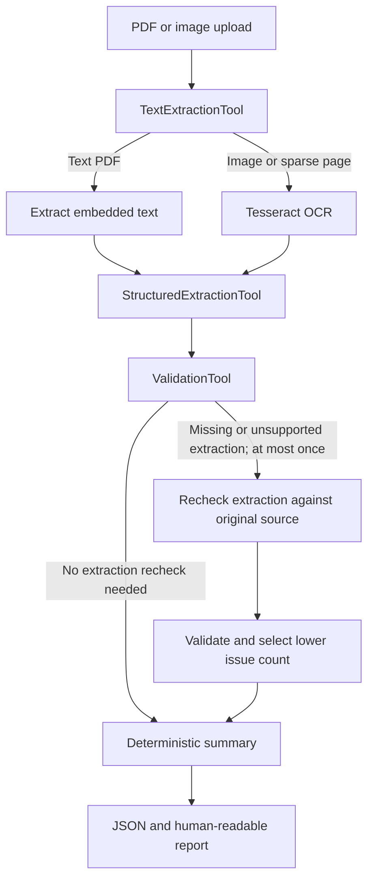

# Document Intelligence Agent

A single-repository implementation of the Appfusion AI/ML take-home assessment. Upload a PDF or image, extract an invoice or receipt into a typed schema, validate the values, and generate a short report.

Includes **DocLens**, a responsive upload and review interface, a FastAPI API, and a CLI. The offline demo runs without an API key. Live extraction uses Google Gemini structured JSON output.


## Quick start

Python 3.10+ is required. From this repository:

```powershell
python -m venv .venv
.\.venv\Scripts\Activate.ps1
python -m pip install -e ".[dev]"
Copy-Item .env.example .env
python -m uvicorn docintel.api:app --host 127.0.0.1 --port 8000
```

On macOS/Linux, activate with `source .venv/bin/activate` and copy configuration with `cp .env.example .env`.

Open **http://127.0.0.1:8000**. Click **Invoice**, **Receipt**, or **Mismatch**. These samples go through the real PDF reader, a clearly labeled deterministic demo parser, the validator, and the summarizer. The mismatch sample preserves the incorrect printed total and returns `needs_review`.

The `demo` provider only understands the bundled labeled sample layout. It is **not an LLM** and does not claim to extract arbitrary documents. Switch to `gemini` for the assessment's LLM workflow.

## Live LLM extraction

Set these values in your local `.env` (which Git ignores):

```dotenv
DOCINTEL_PROVIDER=gemini
GEMINI_API_KEY=your-key-here
GEMINI_MODEL=gemini-3.8-flash
```

Create a Gemini API key in [Google AI Studio](https://aistudio.google.com/api-keys), add it to `.env`, and restart the server. `GEMINI_MODEL` can be another Gemini model supporting structured output. The Google Gen AI SDK calls `models.generate_content` with `response_mime_type="application/json"` and the document's JSON schema, then validates the result using Pydantic. It handles blocked prompts, incomplete output, malformed JSON, timeouts, and provider errors. See the [official SDK structured-output documentation](https://googleapis.github.io/python-genai/#json-response-schema).

Text extraction and validation run locally. In live mode, **extracted page text is sent to Google Gemini** and is subject to Google's applicable data-use terms. The key is read server-side and is never sent to the browser. Use synthetic documents for assessment demonstrations.

The SDK is constrained to the 2.33 release series to retain Python 3.10 compatibility. Live extraction requires a Gemini key; keys from other providers are not interchangeable. The offline demo remains available with `DOCINTEL_PROVIDER=demo`.

## Scans and images

Text PDFs work immediately. PNG/JPEG images and PDFs with sparse or missing text layers use local Tesseract OCR. Install Tesseract and the appropriate language data, then put it on PATH or set:

```dotenv
TESSERACT_CMD=C:\Program Files\Tesseract-OCR\tesseract.exe
OCR_LANGUAGE=eng
```

For Linux: `sudo apt-get install tesseract-ocr tesseract-ocr-eng`. The Docker image includes Tesseract. Missing OCR returns an actionable `503 ocr_unavailable`, never fabricated text.

```sh
docker compose up --build
```

The container binds to localhost port 8000, runs as a non-root user, and reads configuration from `.env`. Copy `.env.example` first. Additional languages require their Tesseract language packs.

## API and CLI

- `GET /` — review interface
- `GET /health` — liveness, provider, configuration presence, and limits; does not test provider reachability
- `GET /docs` — interactive OpenAPI documentation
- `POST /api/analyze` — multipart field `file`, returns a full `DocumentReport`
- `GET /api/examples/invoice` (also `receipt`, `inconsistent`) — synthetic PDFs

```sh
curl -F "file=@src/docintel/samples/invoice.pdf" http://127.0.0.1:8000/api/analyze
docintel src/docintel/samples/invoice.pdf --provider demo --output output/report.json
```

On PowerShell, use `curl.exe`. CLI exit codes: `0` = checks passed, `2` = processed but needs review, `1` = processing failed.

Example `document` section (abbreviated):

```json
{
  "document_type": "invoice",
  "vendor": "ABC Supplies Sdn Bhd",
  "invoice_number": "INV-10234",
  "invoice_date": "2026-01-15",
  "due_date": "2026-02-15",
  "total_amount": "3250.00",
  "currency": "MYR",
  "line_items": [
    {"description": "Consulting services", "quantity": "2", "unit_price": "1000.00", "amount": "2000.00"},
    {"description": "Integration support", "quantity": "5", "unit_price": "200.00", "amount": "1000.00"}
  ]
}
```

Monetary values and quantities serialize as **decimal strings**, preserving precision instead of converting money to binary floating point. Missing fields remain `null`. Reports also contain validation findings, page text, source quotes, a SHA-256 fingerprint, request ID, provider/model information, and a timed tool trace.

## Workflow and tool usage



`DocumentAgent` is a bounded, tool-using orchestrator with explicit branching. The Python orchestrator selects tools; the LLM does not receive shell, file, or network tools. This makes the workflow reproducible and inspectable without an agent framework. A recheck only happens for extraction problems (missing fields, invalid dates/currency, or unverified evidence), never solely to make incorrect arithmetic balance. If the recheck fails or has no better validation score, the first extraction is retained.

The model handles semantic extraction; Python handles arithmetic, business checks, and summarization. This avoids a second model call for the summary and prevents the summary from inventing financial facts. An error-free recheck is still an extraction to inspect, not proof of truth.

## Validation rules

- Required vendor, date, currency, total; invoice number is required for invoices, optional for receipts.
- Valid ISO dates and currency codes; due date cannot precede invoice date.
- Decimal arithmetic for quantity × unit price, sum of line amounts, and subtotal + tax − discount.
- Tolerance of one currency minor unit; 0-, 2-, 3-, and selected 4-decimal currencies are supported.
- Missing tax/discount is **not** silently treated as zero. Incomplete reconciliation is a warning.
- Unsupported magnitudes, negative values, missing items, and incomplete lines are flagged.
- Evidence quotes must occur on the cited source page. This verifies quote membership, not full semantic entailment.
- Any error or warning produces `needs_review`. `passed` means the configured checks passed, not that the document is authentic.

## Engineering decisions and limits

- Limits: 10 MB, 10 pages, 60,000 extracted characters, bounded rendered image pixels; configurable in `.env`.
- Multipart bodies are bounded before parsing, even without `Content-Length`. Extensions and decoded content are checked.
- Two concurrent document processors per process, with fast rejection when busy. Blocking OCR/SDK work runs outside the event loop; PDFium rendering is serialized for thread safety.
- Provider timeout and at most two SDK retries; at most one semantic recheck (up to two extraction calls, each potentially retried by the SDK). OCR has a per-page timeout.
- Request IDs and tool durations in logs; no document text, filenames, API keys, or financial values are deliberately logged.
- No durable upload storage or document database. Multipart parsing may use temporary spooled files that are closed after the request. Reports remain in the browser until cleared or downloaded.
- Document text is untrusted input. The prompt separates instructions from evidence; UI rendering uses `textContent` and restrictive resource policies.
- This is a production-oriented **assessment service**, not a hardened public financial platform. It has no user accounts, distributed rate limiting, or background jobs. Keep it on localhost; an external deployment needs authentication, gateway limits, a worker queue, and process isolation for untrusted PDF parsing.
- PDF embedded-text detection is heuristic; hybrid pages with misleading text layers, handwriting, complex tax-inclusive layouts, credit notes, line-level discounts, and multiple invoices in one file may need review. One document is extracted per upload. There is no accuracy claim against a real-world benchmark.

## Test and maintain

```sh
python -m pytest --cov=docintel --cov-report=term-missing
python -m ruff check .
python -m ruff format --check .
python scripts/generate_samples.py
```

Tests use synthetic PDFs and mocked provider responses; no paid API calls or API keys are required. OCR integration tests run when a local Tesseract binary is available and otherwise skip with a reason. GitHub Actions installs Tesseract and runs tests and lint checks. `requirements.lock` pins the tested development environment; install it before `pip install --no-deps -e .` for a pinned setup.

Verified during implementation:

| Environment | Result |
| --- | --- |
| Windows, Python 3.10 | 70 passed; 2 real OCR tests skipped because Tesseract is absent |
| Docker/Linux, Python 3.12 + Tesseract | All 72 tests passed, including real image and scanned-PDF OCR; 96% backend coverage |
| Browser, desktop and 390px mobile | Samples, validation errors, JSON/source views, download, and invalid-file handling passed; no JavaScript errors or horizontal page overflow |
| Gemini SDK | JSON-schema request and parsed-response round trip tested using a mock HTTP transport; paid live model extraction has not been exercised |

## Repository map

```text
src/docintel/
  api.py             FastAPI routes, limits, request IDs
  agent.py           Bounded workflow, trace, summary
  reader.py          PDF text and OCR tools
  extractors.py      Gemini and explicit demo implementations
  validation.py      Deterministic financial checks
  models.py          Shared Pydantic schemas
  config.py          Environment settings
  cli.py             Command-line entry point
  static/            DocLens upload/review interface
  samples/           Synthetic PDFs and a scan/image
tests/               Reader, validator, agent, SDK, API, CLI tests
scripts/             Reproducible sample generation
.github/workflows/   CI
```

Assessment mapping: structured extraction → `extractors.py` + `models.py`; tool usage → reader/extractor/validator; agent workflow → `agent.py`; engineering → API, config, error handling, tests, container, CI, and this documentation. All components live in this repository.
